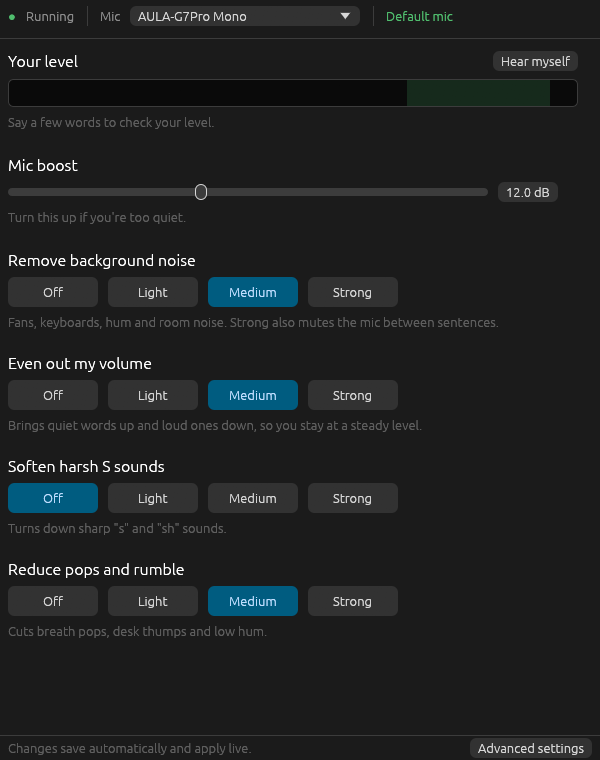
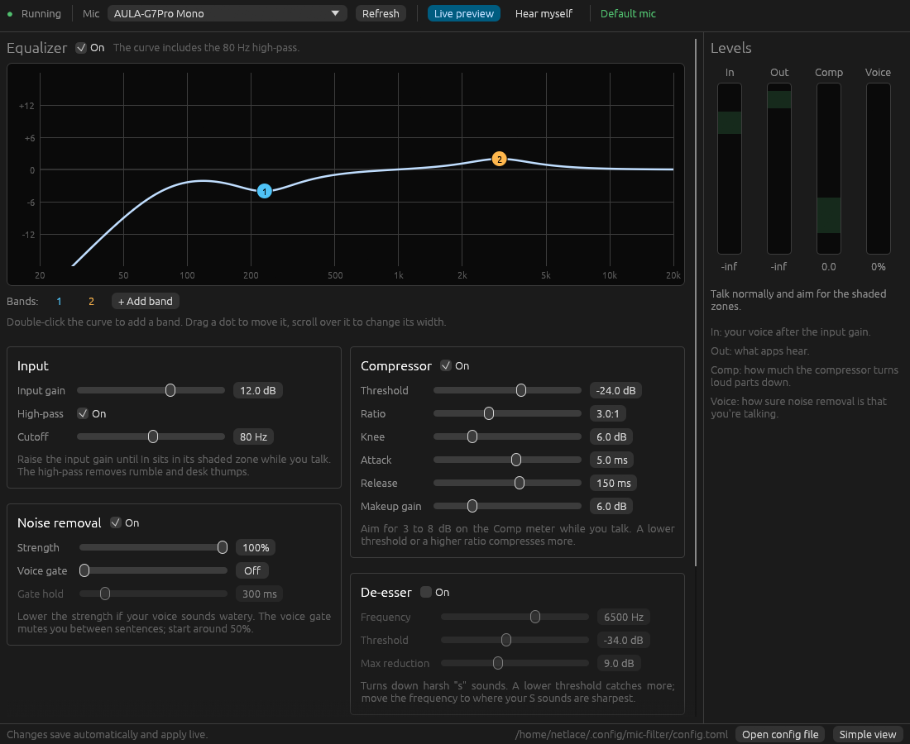

# mic-filter

mic-filter processes your microphone once for every app. It reads any mic you choose, runs it through gain, a high-pass filter, RNNoise noise suppression, EQ, a compressor, a de-esser and a limiter, and passes the result to a virtual mic. On Linux mic-filter creates that mic itself, named **Mic Filter**. On macOS it plays into [BlackHole](https://github.com/ExistentialAudio/BlackHole), a free virtual audio device that apps list as **BlackHole 2ch**. Every app that selects the virtual mic hears the same processed voice, so per-app noise suppression and auto gain can stay off.

mic-filter runs on Linux with PipeWire and on macOS 11 or newer. The macOS version is new and hasn't run on a Mac yet.[*](#speculation) Windows is planned.

## How it works

```
Linux: real mic --> mic-filter --> "Mic Filter" virtual mic --> Discord, Zoom, OBS, browsers, ...
macOS: real mic --> mic-filter --> BlackHole 2ch ----------> Discord, Zoom, OBS, browsers, ...

inside mic-filter:
  input gain -> high-pass -> RNNoise -> EQ -> compressor -> de-esser -> output gain -> limiter
```

- mic-filter is a separate process. If it crashes, PipeWire and the rest of your audio keep running.
- On Linux, the real mic only runs while an app is recording from Mic Filter. With no app recording, mic-filter uses no CPU. On macOS, nothing tells mic-filter whether an app is recording from BlackHole, so the mic stays open while mic-filter runs and the orange mic indicator stays on.
- Processing runs inside the same PipeWire cycle that captures the audio. The added delay is 20 ms with noise suppression on (RNNoise works in 10 ms frames and lags one frame) and 0 ms with it off.
- On the development machine the chain takes about 18 microseconds per 5.3 ms audio cycle, which is about 0.3% of one CPU core.
- Config edits apply live while it runs, including switching to a different mic. An invalid edit is rejected with an error and the previous settings stay in effect.
- The capture side and the virtual mic share a PipeWire link group. WirePlumber refuses to link a node to its own link group, so mic-filter can never record its own output, even when Mic Filter is the system default. On macOS, mic-filter skips BlackHole when it picks a mic.
- On macOS, the mic and BlackHole each run on their own clock, and no two clocks agree exactly. mic-filter resamples from the mic's rate to 48 kHz and adjusts the ratio by up to 0.5% to keep a steady buffer of one mic callback plus 2 ms between them. A change that small is inaudible, and the buffer neither grows nor runs dry.

## Requirements

### Linux

- Linux with PipeWire 1.0 or newer and WirePlumber.
- Rust 1.95 or newer. Install it with [rustup](https://rustup.rs).
- PipeWire development headers and clang:

  | Distro | Command |
  | --- | --- |
  | Ubuntu, Debian, Zorin, Mint, Pop!_OS | `sudo apt install libpipewire-0.3-dev libspa-0.2-dev clang pkg-config` |
  | Fedora | `sudo dnf install pipewire-devel clang` |
  | Arch | `sudo pacman -S pipewire clang` |

### macOS

- macOS 11 or newer, on Apple Silicon or Intel.
- BlackHole 2ch: `brew install blackhole-2ch`, or the installer from [existential.audio](https://existential.audio/blackhole/).
- Rust 1.95 or newer. Install it with [rustup](https://rustup.rs).
- The Xcode command line tools: `xcode-select --install`.

## Install

### Linux

```bash
git clone https://github.com/tylerhartless/mic-audio-filter.git
cd mic-audio-filter
./scripts/install.sh
```

The script:

1. Builds mic-filter and installs it to `~/.cargo/bin/mic-filter`.
2. Writes `~/.config/mic-filter/config.toml` if no config exists yet. The starting mic is the system default when that is a real mic, otherwise the one that looks most like a headset. Change it any time in the window or with `mic-filter use`.
3. Adds **Mic Filter** to your app menu. It opens the tuning window.
4. Installs and starts the `mic-filter` systemd user service, which starts with PipeWire at login.

Then pick **Mic Filter** as the input in each app, or make it the system default:

```bash
pactl set-default-source mic_filter
```

### macOS

```bash
brew install blackhole-2ch
git clone https://github.com/tylerhartless/mic-audio-filter.git
cd mic-audio-filter
./scripts/install.sh
```

On a Mac, the script:

1. Checks that BlackHole is installed.
2. Builds mic-filter, installs it to `~/.cargo/bin/mic-filter`, and copies it into `~/Applications/Mic Filter.app`.
3. Writes `~/.config/mic-filter/config.toml` if no config exists yet, picking the starting mic the same way as on Linux.
4. Installs and starts a launchd agent, `~/Library/LaunchAgents/io.github.tylerhartless.mic-filter.plist`, which runs mic-filter at login.

macOS asks once whether Mic Filter may use the microphone. Allow it. If it doesn't ask, and the Mic Filter window says your mic sends pure silence, turn on Mic Filter under System Settings > Privacy & Security > Microphone.

Then pick **BlackHole 2ch** as the mic in each app. You can also make it the system input under System Settings > Sound > Input. When mic-filter follows the system default and the default is BlackHole, it uses the mic that looks most like a headset instead, so it never records itself.

Each push to `main` also builds `Mic Filter.app` for Apple Silicon and Intel on GitHub's Mac runners, under the **macOS** workflow's artifacts. That build carries no developer signature, so macOS blocks it until you remove the download flag with `xattr -dr com.apple.quarantine "Mic Filter.app"`. The install script is the supported way to install.

### Both

In apps that have their own processing (Discord, Zoom, Teams, browsers), turn off noise suppression and automatic gain control so they don't fight mic-filter.

## Choosing a mic

mic-filter works with any input PipeWire has: USB and Bluetooth headsets, analog jacks, webcams, audio interfaces, and other virtual sources. Pick one with `mic-filter use`:

```bash
mic-filter use           # numbered picker
mic-filter use 2         # by number from `mic-filter list`
mic-filter use headset   # by part of its name
mic-filter use default   # follow the system default mic
```

`mic-filter list` shows the numbers:

```
  1. USB Headset Mono  (in use)
     alsa_input.usb-Headset_Maker-00.mono-fallback
  2. Built-in Audio Analog Stereo  (system default)
     alsa_input.pci-0000_00_1f.3.analog-stereo
  3. Webcam Analog Stereo
     alsa_input.usb-Webcam-02.analog-stereo
  d. Follow the system default mic
```

On macOS the second line of each entry is the device's CoreAudio UID.

The choice is saved as `[input] device` in the config. A running mic-filter switches within a second. The virtual mic stays up during the switch, so apps that have Mic Filter selected keep it and hear a short gap.

When the chosen mic is unplugged, PipeWire moves the capture to another available mic, or leaves it waiting when there is none. When the mic is plugged back in, mic-filter captures from it again.[*](#speculation)

`default` follows the system default mic. When Mic Filter itself is the default, PipeWire picks the highest-priority other mic that has something plugged in, and that can be a webcam or the built-in jack. Naming the mic with `use` is more predictable.

## Usage

| Command | Effect |
| --- | --- |
| `mic-filter gui` | Opens the tuning window. |
| `mic-filter run` | Runs the virtual mic. This is the default when no command is given. |
| `mic-filter run --meter` | Same, with a live level meter in the terminal. |
| `mic-filter list` | Lists the mics, numbered, with the one in use and the system default marked. |
| `mic-filter use [mic]` | Switches to a mic: a number, part of a name, a full node name, or `default`. Asks when no mic is given. |
| `mic-filter init` | Writes a starter config. `--device <mic>` picks the mic, `--force` overwrites. |
| `mic-filter check` | Validates the config file and exits. |

Every command takes `--config <path>` to use a config other than `~/.config/mic-filter/config.toml`.

## Tuning

Open **Mic Filter** from the app menu (on macOS, from `~/Applications`), or run `mic-filter gui`.



- **Mic:** the mic to process. Switching happens live.
- **Your level:** say a few words, and the bar tells you whether you're too quiet, too loud, or good. **Hear myself** plays your processed mic into your headphones.
- **Mic boost:** turn it up if you're too quiet.
- **Remove background noise, Even out my volume, Soften harsh S sounds, Reduce pops and rumble:** pick Off, Light, Medium or Strong.
- **Unmute level:** appears under Strong, which mutes you when you aren't talking. The bar shows what the mic hears after noise removal and turns green when it unmutes you. Sounds quieter than the line never unmute you, even ones that sound like a voice, such as people or a TV across the room. Drag the line, or press **Set from my voice** and talk for four seconds to put it 15 dB below your usual level.

Every change saves and applies right away.

### Advanced settings

**Advanced settings**, at the bottom of the window, opens every setting. **Simple view** goes back.



- **Equalizer:** the curve is the combined response of the high-pass and every EQ band. Drag a dot to move a band, scroll over it to change its width (Q), double-click the curve to add a band, and right-click a dot to remove it. The row under the curve edits the selected band's type, frequency, gain and Q.
- **Input, Noise removal, Compressor, De-esser, Output:** every other setting, with a hint under each card.
- **Levels:** four live meters. The shaded zones are the targets while you talk.
- **Live preview** (Linux) keeps the mic running while the window is open, so the meters move even when no app is recording. On macOS the mic always runs, so there is no switch for it.

The four simple controls are presets for these settings. A setting changed by hand here shows as **Custom** in the simple view until you pick a level again.

The window, the service and the config file stay in sync: an edit made in a text editor shows up in the window within a second.

| Meter | Meaning | Target while speaking |
| --- | --- | --- |
| In | Peak level after the input gain | -18 to -10 dB. Raise the input gain if lower. |
| Out | Peak level of what apps receive | -9 to -3 dB. Adjust the compressor's makeup gain or the output gain. |
| Comp | Gain reduction from the compressor | 3 to 8 dB. More means the threshold is too low. |
| Voice | RNNoise's confidence that you are talking | High while talking, near 0 while silent. |

Common adjustments:

- **Background noise between sentences:** pick Strong under Remove background noise, which mutes the mic when you're not talking. If word endings get cut off, raise Gate hold under Advanced.
- **Voices or noise across the room unmute you:** drag the Unmute level line to the right of where the bar reaches while you're silent. If the starts of your words get cut off, drag it left.
- **Voice sounds watery or robotic:** pick Light under Remove background noise.
- **S sounds still harsh on Strong:** under Advanced, lower the De-esser threshold, or move its frequency to where your S sounds are sharpest.
- **Boomy or muddy:** pick Strong under Reduce pops and rumble, or cut around 200 to 300 Hz in the EQ.
- **Mains hum:** add a notch band at 60 Hz with a Q of 10 (50 Hz in Europe and most of Asia).

### From the terminal

The service and a manual `run` would both create a Mic Filter node, so stop the service first (on macOS, `launchctl bootout gui/$(id -u)/io.github.tylerhartless.mic-filter`):

```bash
systemctl --user stop mic-filter
mic-filter run --meter
```

Record from Mic Filter in any app and talk normally. The meter line shows the same four readings:

```
in  -16.2 dB [#############       ]  out  -6.8 dB [##################  ]  comp -5.1 dB  voice  97%
```

Edit `~/.config/mic-filter/config.toml` in another window and save. When you're done, press Ctrl+C and run `systemctl --user start mic-filter` (on macOS, run `./scripts/install.sh` again, or log out and back in).

## Configuration

`mic-filter init` writes a commented config that documents every option. The sections are:

| Section | Purpose | Live reload |
| --- | --- | --- |
| `[input]` | `device`: the mic's node name on Linux or UID on macOS, or `"default"`. `mic-filter use` sets it for you. | Yes |
| `[output]` | Linux: `name` and `description` of the virtual mic. macOS: `name` of the device to play into, `"BlackHole 2ch"` by default. | Restart needed |
| `[gain]` | `input_db` boost before processing, `output_db` trim before the limiter. | Yes |
| `[highpass]` | Removes rumble below `freq_hz`. | Yes |
| `[denoise]` | RNNoise suppression with `strength`, plus the optional voice gate. The gate opens for sounds RNNoise rates as a voice (`vad_threshold`) that also peak above `gate_level_db`. | Yes |
| `[eq]` | Up to 16 bands: `peaking`, `low_shelf`, `high_shelf`, `low_pass`, `high_pass`, `notch`. | Yes |
| `[compressor]` | Soft-knee compressor: `threshold_db`, `ratio`, `knee_db`, `attack_ms`, `release_ms`, `makeup_db`. | Yes |
| `[deesser]` | Cuts the band around `freq_hz` while it's louder than `threshold_db`, by up to `max_reduction_db`. | Yes |
| `[limiter]` | Peak limiter at `ceiling_db`, so the output never clips. | Yes |

Unknown keys and out-of-range values are errors, so mic-filter reports typos.

## Service

### Linux

```bash
systemctl --user status mic-filter     # is it running?
systemctl --user restart mic-filter    # apply [output] changes
journalctl --user -u mic-filter -f     # logs
systemctl --user disable --now mic-filter
```

If PipeWire restarts, mic-filter exits and systemd starts it again against the new PipeWire.

### macOS

```bash
launchctl print gui/$(id -u)/io.github.tylerhartless.mic-filter        # is it running?
launchctl kickstart -k gui/$(id -u)/io.github.tylerhartless.mic-filter  # apply [output] changes
tail -f ~/Library/Logs/mic-filter.log                                  # logs
launchctl bootout gui/$(id -u)/io.github.tylerhartless.mic-filter       # stop until next login
rm ~/Library/LaunchAgents/io.github.tylerhartless.mic-filter.plist      # don't start at login
```

When a mic is unplugged, mic-filter switches to the system default mic, and back once the chosen mic returns. When BlackHole is missing, it logs the problem and checks again every second.

## Troubleshooting

- **Mic Filter is missing from apps:** check `systemctl --user status mic-filter` and the journal.
- **Wrong mic:** run `mic-filter use` and pick the right one.
- **`capture error: no target node available` in the log:** no usable mic is connected. PipeWire skips inputs with nothing plugged into them, such as an empty analog jack. Capture resumes once a mic appears.
- **Another filter records from Mic Filter:** a filter whose own mic is unplugged, such as a PipeWire filter-chain with a `target.object`, can fall back to recording from Mic Filter. WirePlumber then refuses to let mic-filter use that filter as its input because it would form a loop, and mic-filter logs `no target node available`. Point mic-filter at the real mic, or remove the other filter.
- **Echo of other people:** mic-filter has no echo cancellation. Use headphones.
- **macOS: apps hear silence from BlackHole 2ch:** open Mic Filter. If it says your mic sends pure silence, turn on Mic Filter under System Settings > Privacy & Security > Microphone, then restart it with `launchctl kickstart -k gui/$(id -u)/io.github.tylerhartless.mic-filter`. If the window says mic-filter isn't running, read `~/Library/Logs/mic-filter.log`.
- **macOS: apps hear your computer's sound along with your voice:** the system output is set to BlackHole, so everything playing goes into it. Choose your speakers or headphones under System Settings > Sound > Output.

## Project layout

| Path | Contents |
| --- | --- |
| `crates/dsp` | The processing chain. Pure Rust with no OS or audio-device code, so it carries over to other platforms. |
| `crates/mic-filter` | The program: CLI, config, the PipeWire backend (`engine.rs`), the macOS backend (`cpal_engine.rs`) and its clock bridge (`bridge.rs`), the meter socket (`ipc.rs`), and the window (`gui/`). |
| `crates/mic-filter/macos/Info.plist` | The macOS app description, with the text macOS shows when it asks for microphone access. `build.rs` embeds it in the binary. |
| `packaging/mic-filter.service` | systemd user unit. |
| `packaging/macos/mic-filter.plist` | launchd agent. |
| `scripts/install.sh` | Build, install and enable. Runs `scripts/install-macos.sh` on a Mac. |
| `.github/workflows/macos.yml` | Builds, tests and packages the macOS version on a Mac. |

## Development

```bash
cargo test
cargo clippy --all-targets
cargo run -- run --meter
```

The DSP crate builds and tests on any OS. The `mic-filter` crate needs the PipeWire headers on Linux. `cargo build --no-default-features` leaves out the window, for a headless install.

To work on the macOS version without a Mac:

- `rustup target add aarch64-apple-darwin`, then `cargo clippy --target aarch64-apple-darwin --all-targets` checks that it compiles. Linking needs a Mac.
- `cargo run --features cpal-backend -- run --meter` runs the macOS backend on Linux through PipeWire. It also needs the ALSA headers (`libasound2-dev`). Set `[output] name` to a PipeWire sink for it to play into, such as one end of a `pw-loopback`.

## Speculation

The following statements are untested plans or are based on reading WirePlumber's source code without a live test:

- **Unplug behavior:** a simulated hotplug, where a virtual mic with the configured name was created and removed while an app recorded from Mic Filter, confirmed that capture starts when the mic appears and stops cleanly when it goes away. Moving back from a fallback mic to the returning mic comes from reading WirePlumber 0.4's policy code. Neither has been tested with a real USB or Bluetooth headset unplugged mid-call.
- **macOS:** the macOS version compiles for Apple Silicon and Intel. Its audio code has run on Linux through the `cpal` crate's PipeWire support, including switching mics and changing settings while it runs, and its clock bridge passed simulations of mics running 150 ppm fast and 400 ppm slow for five minutes without a dropout. None of it has run on a Mac. Untested there: CoreAudio's device names and IDs, whether macOS shows the microphone prompt for the launchd agent, the install script, the app bundle, and what happens when another app changes BlackHole's sample rate, which makes mic-filter reopen it.
- **Windows:** the plan is to reuse the macOS backend with VB-CABLE as the virtual device.
